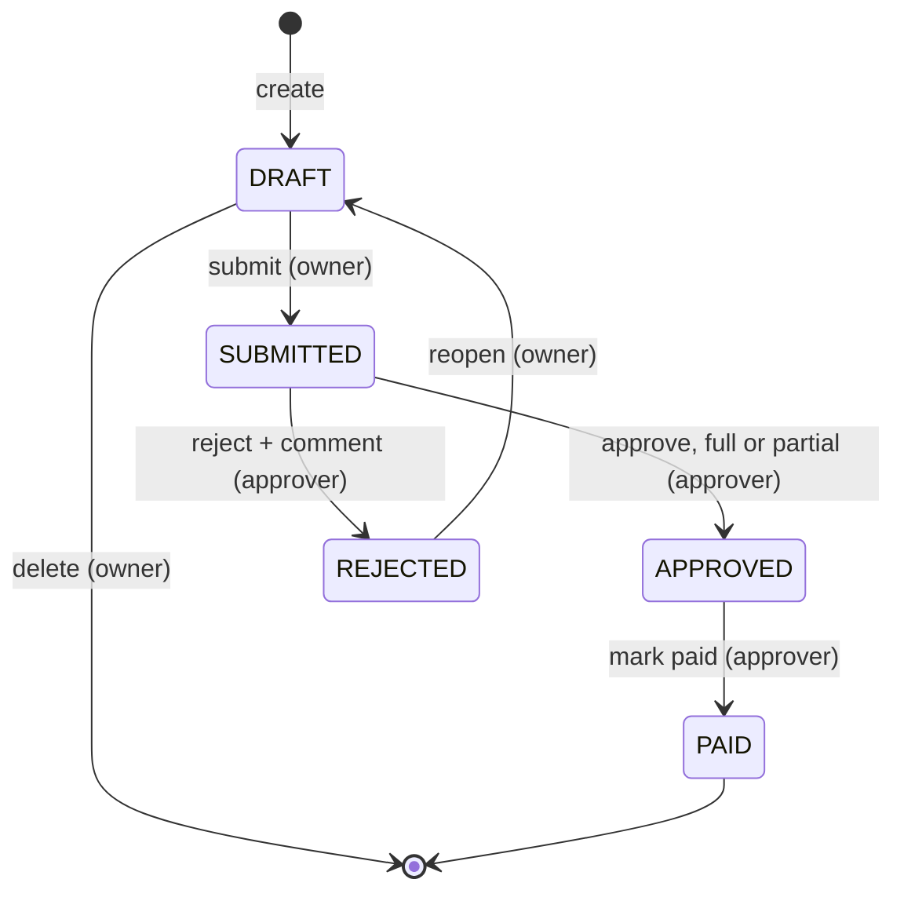

# ERMS: Employee Reimbursement Management System

Employees file expense claims. Approvers review them, approve them in full or in part, reject them with a comment, and mark approved claims as paid. Every action is recorded in a per-claim history.

| Layer    | Tech                                              | Folder                             |
|----------|---------------------------------------------------|------------------------------------|
| Backend  | Python 3.11, Django 5, Django REST Framework      | [erms-backend/](erms-backend/)     |
| Frontend | React 18, Redux Toolkit, Tailwind v4, Vite        | [erms-frontend/](erms-frontend/)   |
| Database | SQLite (Django ORM, migrations committed)         | `erms-backend/db.sqlite3`          |

The frontend talks to the backend only over a REST API (token auth, CORS). It never touches the database. All business rules live in the backend.

---

## Quick start

You need Python 3.11+ and Node 18+.

```bash
# 1. Backend  → http://127.0.0.1:8000/api/
cd erms-backend
python -m venv .venv && source .venv/bin/activate
pip install -r requirements.txt
cp .env.example .env
python manage.py migrate
python manage.py loaddata users categories   # demo users + expense categories
python manage.py seed_claims                 # sample claims in every state
python manage.py runserver

# 2. Frontend → http://localhost:5173  (in a second terminal)
cd erms-frontend
npm install
cp .env.example .env
npm run dev

# 3. Tests
cd erms-backend && pytest                    # 37 tests
```

Or you are just lazy and have docker installed on your machine ? Just do below things

- if you are doing it for the first time
```bash
docker compose up --build
```
- And after the firs time
```bash
docker compose up 
```
And now just navigate to http://localhost:5173 for frontend and our API's are hosted on http://127.0.0.1:8000/api/ .

### Demo users (password for all: `Password@123`)

| Username       | Role     |
|----------------|----------|
| `rahul.verma`  | Employee |
| `neha.gupta`   | Employee |
| `vikram.singh` | Employee |
| `priya.sharma` | Approver |
| `arjun.mehta`  | Approver |
| `admin`        | Approver + Django admin superuser |

The login page has one-click buttons for each user.

### Walkthrough (about 2 minutes)

1. Log in as **rahul.verma**, create a claim, add two items, and **Submit** it.
2. Log in as **priya.sharma**, open the claim, and **Approve** it with a lower amount on one item (a partial approval, which requires a comment). Or **Reject** it with a comment.
3. If you rejected it: log in as rahul again, **Reopen**, fix the items, and **Resubmit**.
4. As priya, approve the claim, then **Mark as paid**.
5. Open the claim from either account and check the status strip and the history timeline.

---

## Claim lifecycle



- A claim can be edited (title, description, items) only in **DRAFT**.
- Rejection does not start a new claim. The owner **reopens** the same claim, edits it, and resubmits it. `submission_count` goes up by one and the event is logged as `RESUBMITTED`.
- **PAID** is terminal.
- Any other transition returns `409 Conflict`.

---

## Data model

```
User (role: EMPLOYEE | APPROVER, employee_code, department)
 │
 ├──< Claim ───────────────< ClaimItem >──── ExpenseCategory
 │     claim_number            category         code, name
 │     status                  description      max_amount (per-item cap)
 │     total_claimed           expense_date     is_active
 │     total_approved          amount
 │     approved_override       approved_amount
 │     reviewer, reviewer_comment, reviewed_at  receipt (pdf/jpg/png)
 │     submission_count, submitted_at
 │     paid_by, paid_at, payment_reference
 │
 └──< ClaimEvent  (append-only audit log)
        claim, actor, action, from_status, to_status, comment,
        data (JSON snapshot of what the action changed), created_at
```

| Entity            | Why it exists |
|-------------------|---------------|
| `Claim`           | One reimbursement request. It holds the status and the denormalised totals, so list screens don't need to sum items. |
| `ClaimItem`       | One expense line. Splitting a claim into items is what makes partial approval meaningful: an approver can cut the hotel line and keep the cab. |
| `ExpenseCategory` | Reference data with a per-item cap and an `is_active` flag (a discontinued category can't be used on new submissions). |
| `ClaimEvent`      | Append-only history. One row per business action, holding before/after status, actor, comment and a JSON snapshot of amounts and items. This covers the "maintain sufficient history" requirement. |

Money is stored as `Decimal(12, 2)` and sent over the API as strings. Floats are never used for money.

**Database-level guards** (CHECK constraints, a last line of defence if the service layer has a bug):
- `ClaimItem.amount > 0`
- `0 ≤ ClaimItem.approved_amount ≤ amount`
- `0 ≤ Claim.total_approved ≤ total_claimed`

---

## Key design decisions

1. **A service layer is the only write path.** [services.py](erms-backend/apps/claims/services.py) has one function per action (`submit_claim`, `approve_claim`, and so on). Views are thin and serializers only check shape. Every rule (who may act, in which state, with what data) is therefore in one file and is easy to test.
2. **Domain exceptions map to HTTP codes in one place.** Services raise `ValidationFailed` (400), `NotPermitted` (403), `NotFound` (404) or `InvalidTransition` (409). [exceptions.py](erms-backend/apps/claims/exceptions.py) is the only file that converts them to responses. All errors share one shape: `{"detail", "code", "current_status"?}`.
3. **Status changes use compare-and-set.** Each transition runs `UPDATE … WHERE id = ? AND status = <expected>` inside a transaction. If zero rows match, another request got there first, so the call returns 409 and rolls back. This handles double clicks and two approvers acting at once. It is needed because SQLite ignores `select_for_update()`; the row lock only applies on PostgreSQL.
4. **The backend tells the UI what is allowed.** Each claim response includes `allowed_actions` (for example `["approve", "reject"]`). The frontend shows buttons from that list instead of re-implementing the rules.
5. **Partial approval works at two levels.** The approver can set an `approved_amount` per item, or set a claim-level `approved_override` that takes precedence over the item sum. An approval below the claimed total is logged as `PARTIALLY_APPROVED` and requires a comment.
6. **Validation runs again on submit.** Item rules (future date, older than 90 days, category cap, inactive category) are checked when an item is added and again when the claim is submitted, so a draft that has become invalid can't be submitted.
7. **Claim numbers come from the primary key** (`CLM-2026-0042`). They are unique and race-free without a counter table.

---

## Edge cases handled

| Case | Behaviour | Test |
|------|-----------|------|
| Invalid transition (approve a draft, pay before approval, reject after approval) | 409 `invalid_transition` | `test_state_and_permissions.py` |
| Duplicate request (submit twice, approve twice) | Second call gets 409 | `test_double_submit_is_409`, `test_double_approve_is_409` |
| Concurrent actions (two approvers at once) | Compare-and-set lets one win; the other gets 409 and its writes roll back | `test_concurrency.py` |
| Editing after submit | 409 | `test_edit_after_submit_is_409` |
| Approver reviewing or paying their own claim | 403 | `test_approver_cannot_review_own_claim` |
| Employee approving (403), or viewing/acting on someone else's claim (404, so the claim's existence isn't leaked) | 403 / 404 | `test_employee_cannot_approve`, `test_other_employee_cannot_see_or_touch_claim` |
| Submit with no items or blank title | 400 | `test_validation.py` |
| Zero, negative or over-cap amounts; future or stale dates; inactive category | 400 with a per-field message | `test_validation.py` |
| Approved amount above the claimed amount, or an item id from another claim | 400 | `test_partial_approval.py` |
| Approved total of zero | 400: "Reject the claim instead" | `test_zero_total_must_be_rejected_instead` |
| Partial approval or rejection without a comment | 400 | `test_partial_requires_comment`, `test_reject_requires_comment` |
| Receipt with a wrong file type or over 5 MB | 400 | `test_receipt_wrong_extension`, `test_receipt_too_large` |
| Resubmission after rejection | Old approvals and reviewer fields are cleared; the history keeps the old rejection | `test_reject_reopen_fix_resubmit` |

---

## Assumptions

- Currency is INR only. There is one level of approval, and any approver can review any submitted claim that isn't their own.
- Approvers are employees too: they can file claims, but another approver has to review and pay them.
- Approvers see all non-draft claims. Employees see only their own claims.
- An expense must be dated today or earlier, and no more than 90 days ago (configurable with `CLAIM_MAX_EXPENSE_AGE_DAYS`).
- Category caps apply per item, not per claim or per month.
- Receipts are optional.
- "Paid" only records a payment reference (an auto-generated one if none is given). No money moves.
- Deleting a draft hard-deletes it and its history, because a claim that was never submitted has no audit value.

## Known limitations

- **Auth is mocked.** Users come from a seeded fixture with no registration or password reset. The token is stored in `localStorage`; a real app would use an httpOnly cookie.
- **Creating a claim is not idempotent.** A double click on "Create" can make two drafts. State-changing actions are protected; creation would need an idempotency key.
- **SQLite.** Fine for a demo, but writes are serialised and `select_for_update` does nothing. Production should use PostgreSQL, where the existing row lock starts working with no code change.
- **Receipts are stored on local disk** and served only when `DEBUG` is on. Production should use object storage (S3).
- **No multi-level approval, delegation or notifications** (email or Slack).

---

## AI usage

I used **Claude** (Anthropic) during development:

- **Backend:** I designed the data model, the lifecycle and the request flow (view → serializer → service → event log), and decided how responsibilities are split across files. I used Claude to review and harden the models (DB constraints, compare-and-set on transitions), to suggest optimisations, and to help write the test cases and fixtures.
- **Frontend:** Built mostly with AI help because of time constraints. I reviewed the code and tested the full flow by hand against the backend.
- **Docs:** Used AI to help structure and tidy these READMEs.

I can explain and change any part of the implementation.
